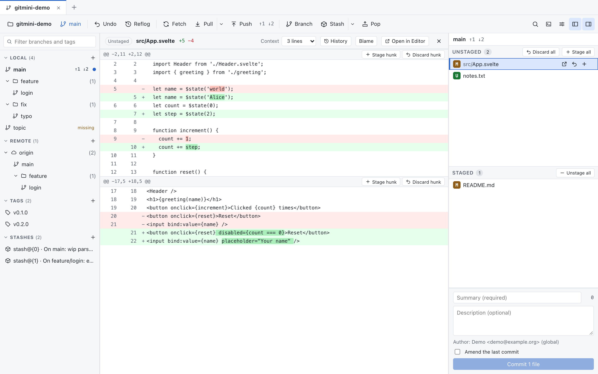

<p align="center">
  
</p>

<h1 align="center">gitmini</h1>

<p align="center">
  A small desktop Git client built with Tauri, Svelte and Rust.<br>
  A readable commit graph, line-level staging and a safety net for the work you throw away.
</p>

<p align="center">
  <a href="https://github.com/ElouanL/gitmini/actions/workflows/ci.yml"></a>
  <a href="https://github.com/ElouanL/gitmini/releases/latest"></a>
  <a href="LICENSE"></a>
  
</p>

<p align="center">
  <a href="https://github.com/ElouanL/gitmini/releases/latest"><b>Download</b></a> ·
  <a href="#features">Features</a> ·
  <a href="#install">Install</a> ·
  <a href="#develop">Develop</a>
</p>

<p align="center">
  <picture>
    <source media="(prefers-color-scheme: dark)" srcset="docs/assets/screenshot-dark.png">
    
  </picture>
</p>

## Why gitmini?

- **Git does the writing.** Git reads use `gix`; every repository change runs through the Git CLI.
- **Hard to lose work.** Undo, a reflog panel, a Discarded tab that keeps what you threw away, and a merge preview that tells you about conflicts before you merge.
- **Precise.** Stage, unstage or discard single lines, and see which words changed inside a line.
- **Keyboard first.** A command palette (Cmd/Ctrl+K) reaches commands, branches, tags, commits and open repositories.
- **Light shell.** Tauri uses the system WebView instead of bundling a browser engine, and the backend is Rust.
- **Open source.** Licensed under GPL-3.0-only.

## Features

**History**

- Commit graph, history search and diffs.
- File history and blame: the commits that changed a file (across renames) with what each one changed, and every line of the file annotated with the commit behind it; open them from a diff, a file's context menu or the palette.

**Changes**

- Staging and commits.
- Line-by-line staging: stage, unstage or discard only the selected lines of a hunk (click the gutter, Shift+click for a range).
- Readable diffs: the words that changed inside a line are highlighted, and the number of context lines (1 to 25, default 3) is adjustable from the diff header, Settings or the palette.

**Branches, merging and tags**

- Branches, merges, rebase, cherry-pick, revert and branch reset.
- One-click conflict resolution: take ours or theirs from the file list or the conflict diff.
- Merge preview: see whether a merge would conflict, and in which files, before starting it, in the merge dialog and after dropping one branch onto another (needs git 2.38 or newer).
- Tags: create lightweight or annotated tags on any commit, push one to a remote, delete one on a remote (after a confirmation), delete locally with undo.

**Remotes**

- Stashes, remotes, fetch, pull and push.
- Optional background fetch (Settings, off by default) with a Pull toast when your branch falls behind.

**Safety net**

- Discarded work is kept: restore a file, hunk or conflict side you threw away from the Discarded tab of the reflog panel (kept as Git objects, for about two weeks).
- Recovery tools for supported operations.

**Navigation**

- Sidebar with branch and tag folders by prefix and a live filter.
- Command palette (Cmd/Ctrl+K) with fuzzy search and the commands you ran last on top; type `@` to jump to a branch or tag (Cmd/Ctrl+Enter checks it out), `#` to find a commit by subject or sha, `/` to switch between repositories.
- Multiple repository tabs.
- Automatic updates in configured release builds.

> [!NOTE]
> GitHub account sign-in is currently disabled. Cloning and configuring remotes by URL remain available; SSH and Git credential helpers can provide authentication.

## Install

Download an installer from this repository's [**Releases**](https://github.com/ElouanL/gitmini/releases/latest) page. Git 2.30 or newer must be installed and available in `PATH`.

| Platform | Installer |
| --- | --- |
| macOS (Apple Silicon or Intel) | DMG |
| Windows | `-setup.exe` (installs for the current user, no administrator rights) |

Linux builds are paused for now: v0.3.0 is the last release with an AppImage and a DEB, and it does not update automatically.

Automatic updates use a separate cryptographic signature. They are supported by the macOS and Windows builds.

<details>
<summary><b>First launch: security prompts</b></summary>

<br>

The initial macOS builds use an ad hoc signature and are not notarized. After the first launch attempt, authorize the application in **System Settings → Privacy & Security → Open Anyway**.

The Windows installer installs for the current user only and needs no administrator rights, but it initially has no Authenticode signature: SmartScreen may show "Windows protected your PC" (**More info → Run anyway**).

Check the release's `SHA256SUMS` before installing. See the [code signing policy](docs/code-signing-policy.md).

</details>

## Develop

Prerequisites: Git ≥ 2.30, Rust stable (minimum 1.93), Node.js 24 or newer, pnpm 10.6.1, Python 3, Bash and [just](https://just.systems). Install the platform's Tauri build dependencies and Tauri CLI 2:

```sh
cargo install tauri-cli --locked --version '^2'
pnpm install --frozen-lockfile
pnpm --dir tests/e2e install --frozen-lockfile
just dev
```

For the frontend with demo data, run `pnpm dev` and open `http://localhost:1420/?mock=1`; the screenshots above are captured that way, at 1440×900, in the light and dark themes. To use the real backend in a browser, see the [development bridge](crates/gitmini-bridge/README.md).

```sh
pnpm check          # Frontend types
pnpm lint           # Frontend and script lint
pnpm test           # Frontend tests
just test           # Rust tests and doctests (requires cargo-nextest)
just lint           # Full repository checks (requires cargo-deny)
just build          # Desktop installers
```

See [CONTRIBUTING.md](CONTRIBUTING.md), [architecture](docs/architecture.md), [testing](docs/testing.md) and [releases](docs/releases.md).

## License

Copyright (c) 2026 gitmini contributors. Licensed under [GNU GPL version 3 only](LICENSE) (`GPL-3.0-only`). Third-party dependencies retain their own licenses. See [NOTICE](NOTICE) for bundled third-party assets. The software is provided without warranty; the full terms are in `LICENSE`.
